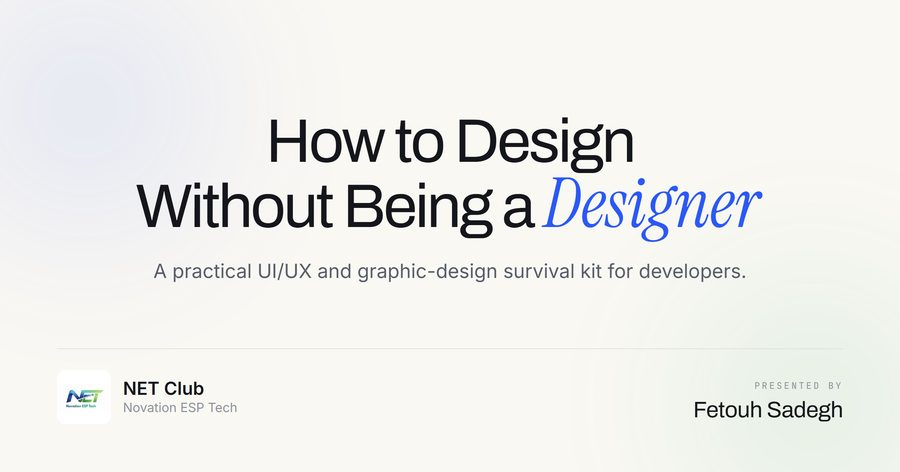

  

  
  

I build web and mobile apps, mostly with Next.js and Supabase, and I design the interfaces and visuals that go with them. I also teach web development at the University of Nouakchott Al Aasriya.

## What I'm building

<table>
  <tr>
    <td width="84" align="center"></td>
    <td><b><a href="https://www.brandak.app">Brandak</a></b> Upload your logo once and get a full catalogue of on-brand designs.</td>
  </tr>
  <tr>
    <td width="84" align="center"></td>
    <td><b><a href="https://soulam.mr">Soulam</a></b> Free practice for Mauritania's civil-service exams, with questions written by the candidates themselves.</td>
  </tr>
  <tr>
    <td width="84" align="center"></td>
    <td><b><a href="https://mawarli.vercel.app">Mawarli</a></b> Describe your door once, with a pin, voice notes and photos, and share one link.</td>
  </tr>
  <tr>
    <td width="84" align="center"></td>
    <td><b>More on the way 🚀</b> A few other projects are in the works, to be announced.</td>
  </tr>
</table>

## Talks

The code of each talk I give lives here, so anyone who attended can open the slides again and run the demos.

<table>
  <tr>
    <td width="50%" valign="top">
      
       <b><a href="https://github.com/fetouh-sadegh/talk-supabase">How Supabase Accelerates Modern Development</a></b>
       Mauritanian Programming Community · 2026
       Slides, the Message Wall app built live on stage, and the attendee challenge.
    </td>
    <td width="50%" valign="top">
      
       <b><a href="https://github.com/fetouh-sadegh/talk-design-without-a-designer">How to Design Without Being a Designer</a></b>
       NET Club, Novation ESP Tech · 2026
       An 85-slide deck, a reference library, a design studio and a gallery for attendees.
    </td>
  </tr>
</table>

## Coming to open source

- **Frankenstein UI**: a local canvas to collect UI references, judge them and assemble new screens from pieces of them, with a coding agent working in the same files.
- **crello-lab**: a faithful HTML renderer for the Crello graphic-design dataset, built as a research instrument.

## Tools I use

  
   
  

